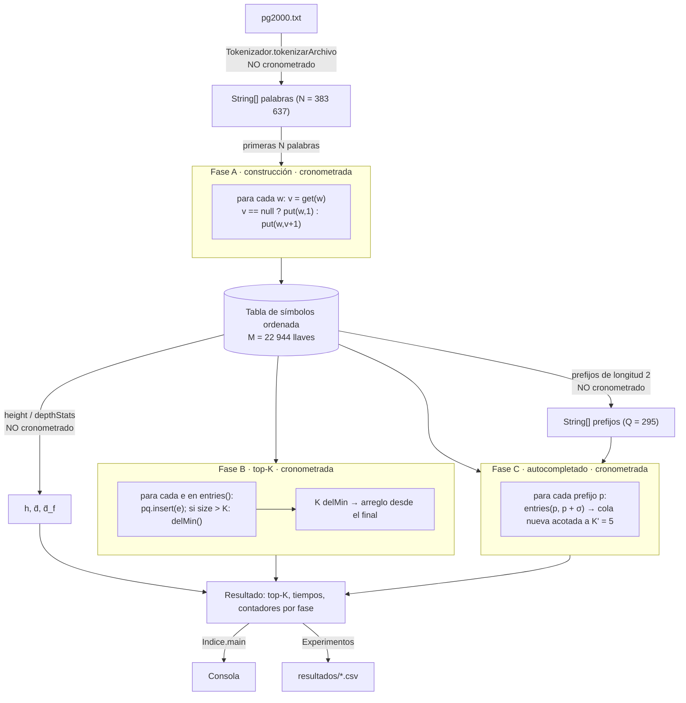
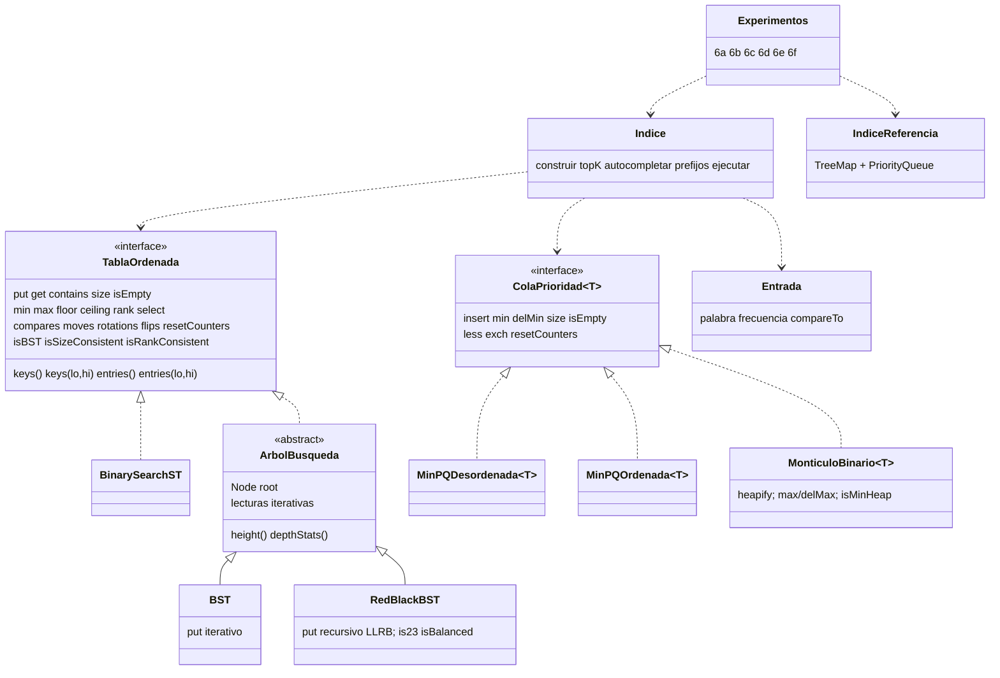
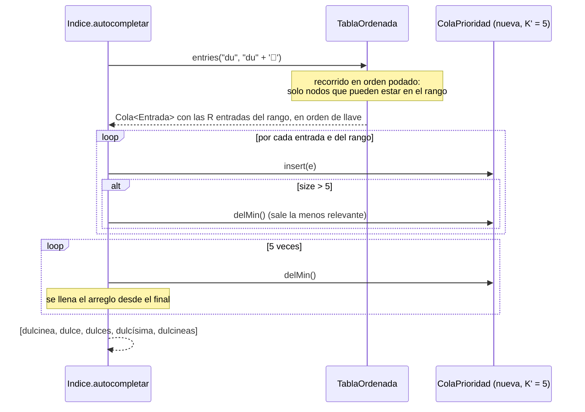
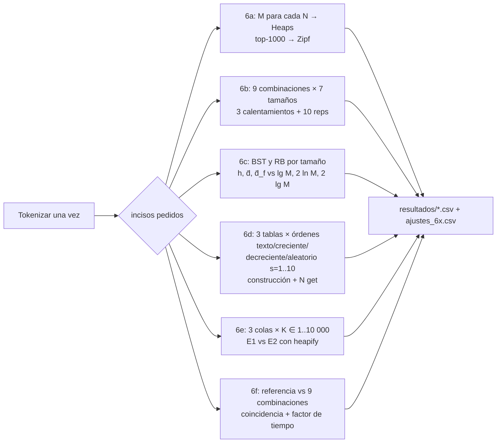

# Flujo del programa

Cómo viajan los datos desde `pg2000.txt` hasta las respuestas y los CSV. El *por qué* de cada
decisión está en [RAZONAMIENTO.md](RAZONAMIENTO.md).

## 1. Vista general



## 2. Clases y responsabilidades



| Archivo | Rol |
|---|---|
| `Tokenizador` | Lee el archivo, recorta encabezado/pie de Gutenberg, minúsculas, regex `[a-záéíóúüñ]+`. |
| `Entrada` | Par inmutable `(palabra, frecuencia)` ordenado por relevancia. |
| `TablaOrdenada` | API común de las tres tablas. |
| `BinarySearchST`, `BST`, `RedBlackBST`, `ArbolBusqueda` | Las tres tablas (los árboles comparten la base). |
| `ColaPrioridad`, `MinPQDesordenada`, `MinPQOrdenada`, `MonticuloBinario` | Las tres colas. |
| `Cola`, `Pila` | Estructuras auxiliares propias (iterables de resultados y recorridos iterativos). |
| `Indice` | Programa del punto 5: fases A, B, C y medición; `main` imprime los valores de verificación. |
| `IndiceReferencia` | Punto 6f: mismas fases con `TreeMap` + `PriorityQueue`. |
| `Experimentos`, `Estadistica` | Punto 6: genera los CSV y los ajustes potenciales. |
| `SeleccionCombinacion` | Punto 4: SHA-256 de los ID mod 9. |

## 3. Una consulta de autocompletado, paso a paso (`p = "du"`)



## 4. Recorrido podado de `keys(lo, hi)` en un árbol

```
apilarIzquierda(x):                     recorrerRango(lo, hi):
  mientras x != null:                     si lo > hi: rango vacío
    si lo < x.key: push(x); x = x.left    apilarIzquierda(root)
    si lo > x.key: x = x.right            mientras la pila no esté vacía:
    si lo = x.key: push(x); parar           x = pop()
                                            si x.key > hi: terminar
                                            emitir (x.key, x.val)
                                            apilarIzquierda(x.right)
```

Invariante: la pila solo contiene nodos con llave ≥ `lo` cuyo subárbol izquierdo ya se descartó o
ya se emitió; el recorrido emite en orden creciente, así que la primera llave > `hi` lo termina.

## 5. Flujo de los experimentos (`Experimentos`)



| CSV | Inciso | Contenido |
|---|---|---|
| `6a_heaps.csv` | 6a | N, M (y logaritmos) para la serie geométrica y el texto completo |
| `6a_zipf.csv` | 6a | rango, palabra, frecuencia del top-1000 |
| `6b_escalamiento.csv` | 6b | por combinación y N: tiempos por fase (media, sd), contadores por fase, M, Q, h, d̄, d̄_f |
| `6c_forma.csv` | 6c | por N y árbol: h, d̄, d̄_f y curvas de referencia |
| `6d_orden.csv` | 6d | por tabla y escenario: construcción y carga de búsqueda (tiempo y contadores), forma |
| `6e_efectoK.csv` | 6e | por cola y K: less, exch, tiempo de la fase B |
| `6e_E1_vs_E2.csv` | 6e | por K: E1 (MinPQ acotada) frente a E2 (heapify de máximos + K delMax), cuál conviene |
| `6f_referencia.csv` | 6f | tiempos por fase de la referencia y de cada combinación, factor y coincidencia |
| `ajustes_6a.csv`, `ajustes_6b.csv`, `ajustes_6e.csv` | 6a, 6b, 6e | a, b y R² de cada ajuste potencial `y = a·x^b` (solo sobre la serie geométrica) |

## 6. Cómo ejecutar cada parte

```bash
./gradlew test                                     # todas las pruebas (assert habilitados)
./gradlew run                                      # índice con RedBlackBST + montículo, texto completo
./gradlew run --args="--tabla BST --cola DESORDENADA --n 50000 --k 10"
./gradlew seleccion --args="<id1> <id2> <id3>"     # combinación asignada (punto 4)
./gradlew experimentos                             # punto 6 completo (~30 min, la mayoría en 6d)
./gradlew experimentos --args="6a 6c --reps 10"    # solo algunos incisos
./gradlew experimentos --args="todos --tabla BST --cola DESORDENADA"   # solo la combinación asignada
```
